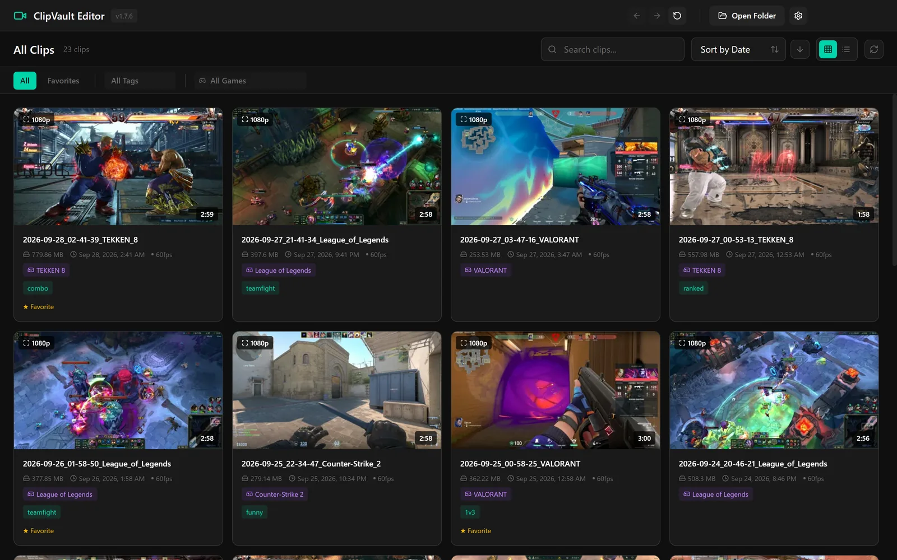

# ClipVault

A lightweight game clipping tool for Windows. Press F9 to save the last two minutes of gameplay (configurable) as a high-quality MP4 with separate desktop/game audio and microphone tracks.

**[Download for Windows](https://github.com/ebrardushullovcii/ClipVault/releases/latest)** · [Website](https://getclipvault.netlify.app) · [Changelog](CHANGELOG.md)



_The clip library groups recordings by game and opens them in the editor._

## Features

- Always-on replay buffer while the app is running.
- Separate desktop and microphone audio tracks.
- Anti-cheat-friendly monitor capture by default.
- NVENC hardware encoding with x264 fallback.
- Clip library, trimming, audio controls, tagging, favorites, and export tools.
- Portable and installer builds for Windows.

## Requirements

- Windows 10/11.
- NVIDIA GPU for NVENC, or CPU encoding through x264 fallback.
- Enough free disk space for local MP4 clips.

## Quick start

Run ClipVault, leave it running in the tray, play normally, then press F9 to save a clip. Saved clips appear in the library where they can be edited and exported.

Settings are stored at `%APPDATA%\ClipVault\settings.json` and can be changed in the Settings UI.

The Windows installer and portable downloads are not code-signed, so Windows may show a SmartScreen warning. Release assets include `SHA256SUMS.txt` for verifying downloads.

## How it is built

A C++ backend uses libobs for capture, encoding and replay-buffer saves. Electron runs the desktop shell and React renders the library and editor. The [architecture decisions](docs/DECISIONS.md) explain the capture pipeline, audio tracks and packaging choices.

### Project structure

```text
ClipVault/
|-- src/           # C++ backend using libobs
|-- ui/            # Electron + React frontend
|-- bin/           # Backend build output and bundled runtime source
|-- config/        # Default settings and game database assets
\-- docs/          # Product goals and durable technical decisions
```

## Building from source

Use Windows with Node.js/npm, Git, CMake 3.20+ and a MinGW C++ compiler available. The OBS setup script downloads the runtime and source headers needed by the native build.

```powershell
npm install
.\setup-obs.ps1
npm run package:portable
```

Useful scripts are defined in `package.json` and `ui/package.json`.

## Checks

`npm test` runs ESLint, TypeScript and formatting checks; it does not run the behavioural regression tests in `ui/tests/`. Those cover editor, audio and packaged-runtime behaviour. Packaged-app checks are separate from static validation; see [Contributing](CONTRIBUTING.md).

## Documentation

- [Product goals](docs/GOALS.md): product goals, boundaries, and source-of-truth guidance.
- [Architecture decisions](docs/DECISIONS.md): durable architecture and implementation rationale.
- [Changelog](CHANGELOG.md): release history.
- [Contributing](CONTRIBUTING.md): contributor guidance.

## Contributing

See [Contributing](CONTRIBUTING.md) for focused changes, validation and the pull-request workflow. Repository working rules are in [AGENTS.md](AGENTS.md).

## License

GPL-2.0-or-later.

This project uses libobs from OBS Studio, which is licensed under GPL-2.0-or-later. As required by the GPL, this project is also licensed under GPL-2.0-or-later.
